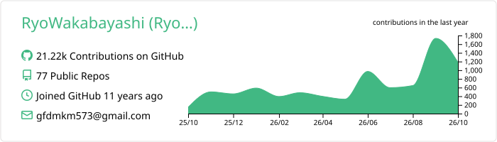
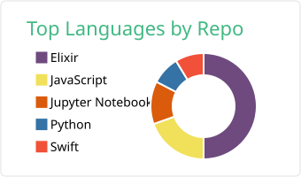
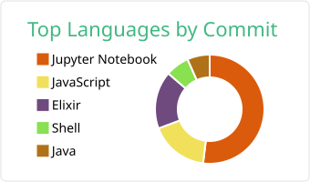
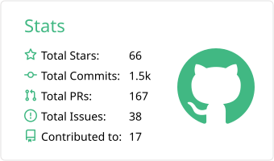
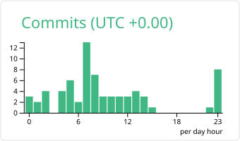

# Hi 👋, I'm Ryo Wakabayashi（若林諒）

大分を拠点にするフルスタックエンジニアです。2007 年から業務システム開発に携わり、
現在は **AWS サーバーレス**・**画像認識 AI / 生成 AI**・**Elixir** を軸に、設計から運用、社内への定着まで一貫して手がけています。

## What I do

- ☁️ **AWS サーバーレス** — マネージドサービス中心の高速開発。高負荷な申込サイトを短期間で構築し、日立 IT ユーザ会論文 優秀賞
- 👁️ **画像認識 AI** — ブランド品識別、粗大ゴミ識別 API、顔識別による卒業アルバム作成支援、リアルタイム顔モザイク、衛星画像解析
- 🤖 **生成 AI** — 社内 RAG チャットの構築、生成 AI ガイドライン策定、ChatGPT / GitHub Copilot / Claude Code の社内導入
- 💧 **Elixir** — Livebook / Nx を使った機械学習・並列分散推論、Livebook 用の Kino ライブラリ開発
- 🎤 **教育・発信** — 社内勉強会 100 回以上、大学でのデータエンジニアリング・AI 講義（毎年 200 人超が受講）

## Projects

| Project | Description | Tech |
|---|---|---|
| [おおいたイベント](https://oita-events.com/) | 大分県内のイベント情報を集めて整理し、主催者の申込ページへつなぐ静的サイト。SEO / AI 検索（AEO）の実験場も兼ねる | Astro, TypeScript, Cloudflare Pages, GitHub Actions |
| [elixir-learning](https://github.com/RyoWakabayashi/elixir-learning) | Elixir と Livebook の学習用ノートブック集 | Elixir, Livebook, Nx |
| [kino_figma](https://github.com/RyoWakabayashi/kino_figma) / [kino_link](https://github.com/RyoWakabayashi/kino_link) / [kino_speaker_deck](https://github.com/RyoWakabayashi/kino_speaker_deck) / [kino_code_pen](https://github.com/RyoWakabayashi/kino_code_pen) | Livebook 上で Figma・リンク・Speaker Deck・CodePen を埋め込み表示する Kino | Elixir, Livebook |
| [phoenix-with-aws-copilot](https://github.com/RyoWakabayashi/phoenix-with-aws-copilot) | Phoenix アプリを AWS Copilot でデプロイするサンプル | Elixir, Phoenix, AWS |
| [open-webui-container-for-jp](https://github.com/RyoWakabayashi/open-webui-container-for-jp) | 日本語用 Open WebUI コンテナ | Docker, LLM |

## Tech Stack

**Languages**

**Frameworks**

**AI / ML**

**Cloud / Infra**

**Database**

## Writing & Speaking

- ✍️ **Qiita** — Elixir / Livebook / AWS / AI の技術記事 → [qiita.com/RyoWakabayashi](https://qiita.com/RyoWakabayashi)
- 📝 **note** — 個人開発（おおいたイベント）の記録やサイト設計の話 → [note.com/elixir_livebook](https://note.com/elixir_livebook)
- 🛰️ **宙畑** — [衛星データ分析におススメの言語は？言語別の特徴まとめとElixir紹介](https://sorabatake.jp/32369/) ほか、Python で学習した衛星画像分類モデルを Elixir で並列分散推論する連載（[学習編](https://sorabatake.jp/33582/) / [推論編](https://sorabatake.jp/33628/)）
- 🎤 **登壇** — ElixirConf EU 2023（オンライン）、JAWS FESTA 2023 ほか多数

## Community

[CLS別府](https://www.cls-beppu.com/) ・ JAWS-UG 大分 ・ JBUG 大分 ・ fukuoka-ex ・ LiveView.jp の運営に参加しています。

## Awards & Certifications

- 🏆 2023 日立 IT ユーザ会 論文 優秀賞「マネージドとアジャイルによる DX 実現の成果」
- 🥈 2017 日本 IBM『Watson Build Challenge』日本部門 準優勝「Virtual Roleplayer」
- 🧊 GitHub Arctic Code Vault Contributor
- 📜 AWS Certified AI Practitioner ・ JDLA E 資格 ・ システムアーキテクト ・ ネットワークスペシャリスト ・ 情報セキュリティスペシャリスト ・ テクニカルエンジニア（データベース）

## GitHub Stats

 

 

